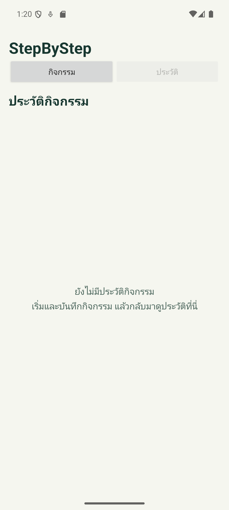
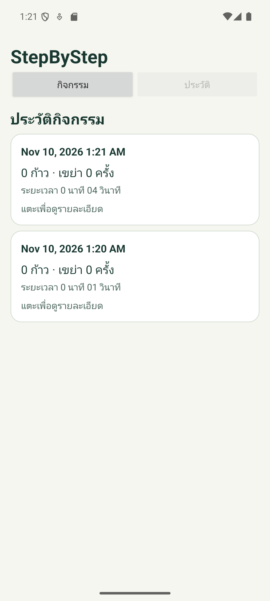
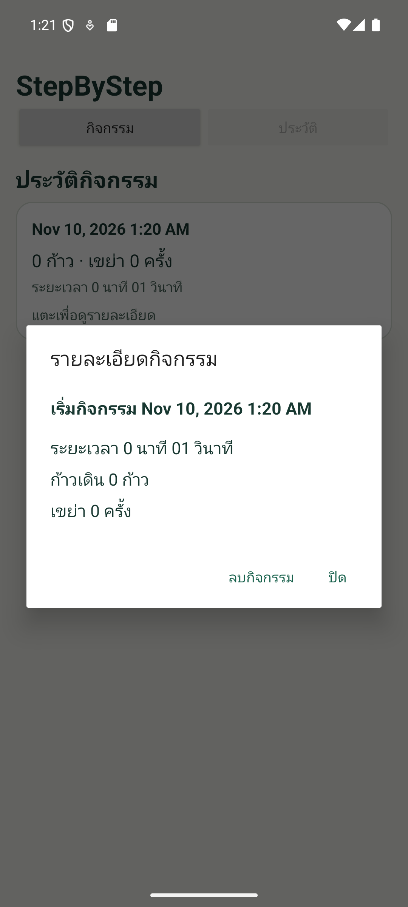
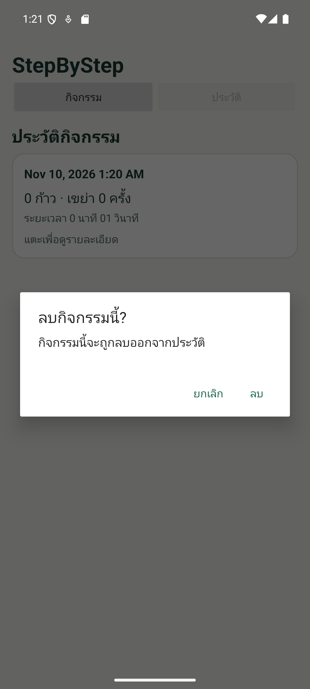
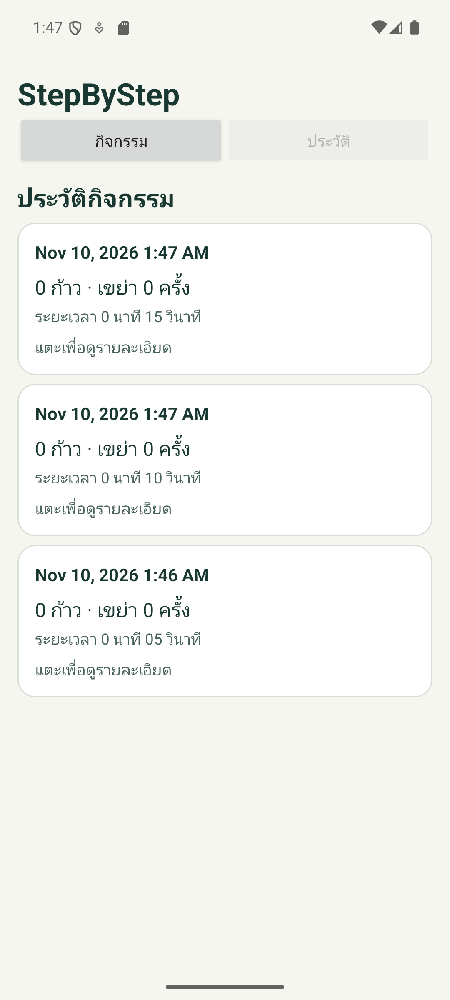
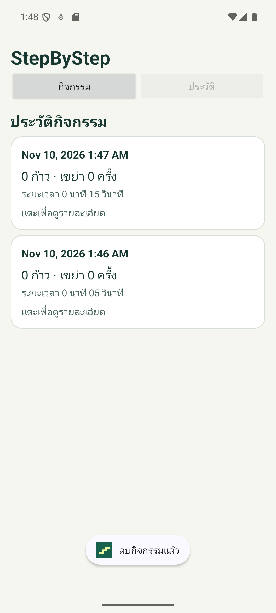
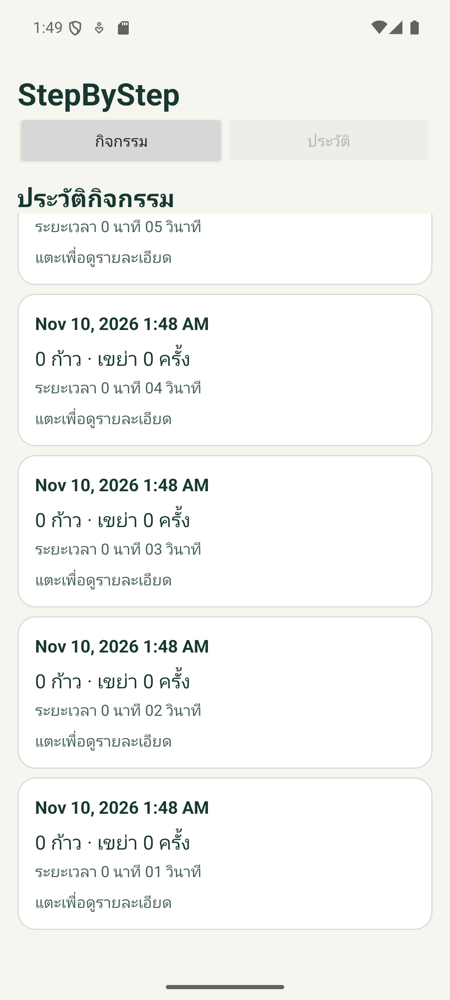
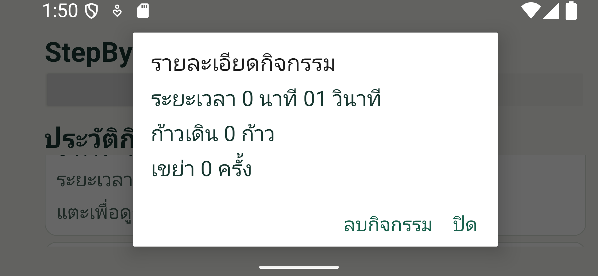

# 04-history

ส่วนประวัติกิจกรรมบน branch `feature/history` ใช้โค้ดใน `StepByStep-4.zip`
เป็นฐาน และเชื่อมกับโปรเจกต์ปัจจุบันผ่าน API เดิม

## ขอบเขตตาม Checklist

- ข้อ 9: แสดงประวัติด้วย RecyclerView เรียงกิจกรรมใหม่ก่อน
- ข้อ 10: แตะรายการเพื่อดูวันเวลา ระยะเวลา จำนวนก้าว และจำนวนเขย่า
  พร้อมแสดงสถานะว่างเมื่อไม่มีประวัติ
- ส่วนหน้าจอของข้อ 8: ขอคำยืนยันก่อนลบ และโหลดประวัติ/หน้าหลักใหม่หลังลบ

## ไฟล์และการเชื่อมต่อ

- `ActivityAdapter.java`: ListAdapter, DiffUtil, stable IDs, รายการและกล่องรายละเอียด
- `item_activity.xml`: การ์ดประวัติที่แตะได้ทั้งใบและมี ripple
- `dialog_activity_detail.xml`: รายละเอียดเลื่อนได้เมื่อพื้นที่จำกัดหรือใช้ตัวอักษรใหญ่
- `history_strings.xml`, `history_colors.xml`: ข้อความภาษาไทยและสีที่เข้ากับหน้าจอเดิม
- `MainActivity.java`: รับ `DeleteAction` ผ่าน `this::confirmDelete`
  และเรียก `store.delete(id)` เมื่อผู้ใช้ยืนยันเท่านั้น
- `show(List<ActivitySession>, TextView)`: รับสำเนาข้อมูลจาก `store.all()`
  โดยไม่แก้ไขลิสต์ต้นทาง และอัปเดตการมองเห็นรายการ/สถานะว่าง

`refresh()` โหลดข้อมูลจาก DBHelper ส่งให้ประวัติ และเรียก `render()` →
`SessionPanel.show()` เพื่อให้ส่วนสถิติใช้กิจกรรมที่เหลือหลังลบ
การคำนวณสถิติเป็นงานส่วน 05-main-session

DBHelper ปัจจุบันเก็บในหน่วยความจำ การคงข้อมูลหลังปิด process ต้องรอรวม
03-database (SQLite) ส่วนประวัติไม่อ่านหรือเขียน SQL โดยตรง
และไม่แก้ไขระบบนับก้าว/ตรวจจับการเขย่า

## วิธีทดสอบ

1. เปิดโปรเจกต์ที่มี `settings.gradle` ใน Android Studio แล้ว Run โมดูล app
2. เปิดแท็บประวัติขณะไม่มีข้อมูล ต้องเห็นข้อความสถานะว่างและคำแนะนำ
3. กลับไปแท็บกิจกรรม บันทึก 3 รอบประมาณ 5, 10 และ 15 วินาที แล้วเปิดประวัติ
   ต้องเห็นครบ 3 รอบ เรียงใหม่ก่อน แตะแต่ละรอบเพื่อตรวจวันเวลา จำนวนก้าว
   จำนวนเขย่า และเวลาเป็นนาที/วินาทีตรงกับแถวที่เลือก
4. แตะการ์ด ตรวจรายละเอียด แล้วกดปิด ต้องกลับสู่ประวัติ
5. เปิดรายละเอียดของแถวกลาง เลือกลบกิจกรรม แล้วกดยกเลิก ต้องยังมีครบ 3 รายการ
6. ทำซ้ำและยืนยันลบแถวกลาง ต้องเหลือรอบ 15 และ 5 วินาที
   แตะรายละเอียดของทั้งสองแถวเพื่อตรวจว่าไม่ได้ลบหรือแสดงข้อมูลผิดรอบ
7. ลบรายการที่เหลือจนหมด ต้องกลับสู่สถานะว่าง
8. บันทึกอย่างน้อย 8 รอบให้เกินหน้าจอ ตรวจลำดับใหม่ก่อนและเลื่อนถึงรายการท้าย
   จากนั้นเปิดรายละเอียดของรายการท้ายเพื่อตรวจข้อมูลหลัง RecyclerView นำแถวกลับมาใช้
9. หมุนหน้าจอและเพิ่มขนาดตัวอักษร ตรวจว่ารายการ/รายละเอียดเลื่อนได้และปุ่มยังใช้งานได้
10. หลังรวม 03 และ 05 ตรวจการคงข้อมูลหลังเปิดแอปใหม่
    และตรวจว่ายอดรวม/สถิติเปลี่ยนตามกิจกรรมที่ลบ

## ตรวจบนเครื่อง

```powershell
.\gradlew.bat --no-daemon testDebugUnitTest assembleDebug lintDebug
git diff --check
```

## ผลตรวจ

วันที่ 10 พฤศจิกายน 2569:

- `testDebugUnitTest assembleDebug lintDebug` สำเร็จ
- Unit tests เดิมของระบบนับก้าวผ่าน 11 กรณี ไม่มี failures/errors/skipped
- Android lint ไม่มี errors มี warnings 21 รายการจาก target SDK,
  dependency และรูปแบบข้อความ/หน้าจอในโค้ดฐาน
- ทดสอบ UI บน Pixel 6a Emulator (API 35) ผ่าน 23 จุดตรวจ:
  สถานะว่าง บันทึกรอบ รายการ รายละเอียด ปิดรายละเอียด ยกเลิกลบ
  เรียงใหม่ก่อน ลบเฉพาะรายการที่เลือก ลบจนหมด และรีเฟรชหน้าหลัก
- ทดสอบการสร้าง Activity ใหม่เมื่อเปลี่ยนขนาดหน้าจอเป็นกว้าง 375dp
  และ font scale 2.0 ทั้งแนวตั้ง/แนวนอน รายการยังอยู่ ปุ่มรายละเอียดใช้งานได้
  และรายละเอียดในแนวนอนมี ScrollView สำหรับเนื้อหาที่เกินพื้นที่
- ตรวจภาพรายการ รายละเอียด กล่องยืนยัน และหน้าจอตัวอักษรใหญ่แล้ว
- `git diff --check` ผ่าน

APK อยู่ที่ `app/build/outputs/apk/debug/app-debug.apk`
ภาพหน้าจอ XML หน้าจอ และผลตรวจ JSON อยู่ใน `app/build/history-smoke/`

Emulator ไม่มี Step Counter และส่วน Shake ยังเป็นโครง จึงทดสอบประวัติ
ด้วยกิจกรรมที่มีจำนวนก้าว/เขย่าเป็น 0 และระยะเวลาต่างกัน
ยังต้องทดสอบข้อมูลจากเซนเซอร์บนมือถือจริงหลังรวมงาน
ส่วนการคงข้อมูลหลังปิด process และการคำนวณยอดรวม/สถิติหลังลบ
ต้องตรวจร่วมหลังรวม 03-database และ 05-main-session

## ภาพผลทดสอบบน Emulator

Pixel 6a, Android 15 / API 35 ใช้กิจกรรมที่บันทึกระหว่างทดสอบ
จำนวนก้าวและเขย่าเป็น 0 ตามข้อจำกัดที่ระบุข้างต้น

| สถานะว่าง | รายการหลายกิจกรรม |
| --- | --- |
|  |  |

| รายละเอียดกิจกรรม | ยืนยันก่อนลบ |
| --- | --- |
|  |  |

## ผลทดสอบเพิ่มเติมตาม Issue #4

ตรวจตามขั้นตอนใน [Issue #4](https://github.com/Micosz/CS364Exercise2/issues/4)
บน Pixel 6a Emulator, Android 15 / API 35 วันที่ 10 พฤศจิกายน 2569
ชุดเพิ่มเติมผ่าน 26 จุดตรวจ ต่อจากชุดพื้นฐาน 23 จุดตรวจข้างต้น

| กรณีที่ตรวจเพิ่ม | ผลจริง |
| --- | --- |
| บันทึก 3 รอบที่ระยะเวลาต่างกัน | บันทึกได้ 5, 10 และ 15 วินาที แสดงครบและเรียง 15 → 10 → 5 |
| รายละเอียดแต่ละรอบ | วันเวลา ระยะเวลา จำนวนก้าว และจำนวนเขย่าตรงกับแถวที่เลือกทั้ง 3 รอบ |
| ยกเลิกลบแถวกลาง | ยังมีครบ 3 รอบและข้อมูลไม่เปลี่ยน |
| ยืนยันลบแถวกลาง | ลบรอบ 10 วินาที เหลือรอบ 15 และ 5 วินาที และเปิดรายละเอียดของทั้งสองรอบได้ถูกต้อง |
| ลบรายการที่เหลือ | กลับสู่สถานะว่าง |
| สร้างรายการจนเกินหน้าจอ | ใช้ 8 รอบ ระยะเวลา 1–8 วินาที เลื่อนถึงครบทั้ง 8 รอบและลำดับยังถูกต้อง |
| รายการท้ายหลังเลื่อน | เปิดรายละเอียดของรอบ 1 วินาทีได้ และข้อมูลตรงกับแถว |
| ตัวอักษรใหญ่และแนวนอนขณะมี 8 รอบ | ที่ความกว้างพื้นฐาน 375dp และ font scale 2.0 ยังเลื่อนถึงรายการท้ายได้ เปิดรายละเอียดและเลื่อนอ่านจำนวนก้าว/เขย่าได้ ปุ่มปิดและลบใช้งานได้ |

ผลตรวจแต่ละจุดและระยะเวลาที่บันทึกจริงอยู่ใน
[issue4-results.json](history-evidence/issue4-results.json)
จำนวนก้าวและเขย่ายังเป็น 0 ตามข้อจำกัดของ Emulator และ branch ที่ระบุไว้ข้างต้น

### วิดีโอยกเลิกและยืนยันลบ

[เปิดหรือดาวน์โหลดวิดีโอสาธิต (MP4 ประมาณ 56 วินาที)](history-evidence/history-demo.mp4)

วิดีโอแสดงประวัติ 3 รอบ เปิดรายละเอียดแต่ละรอบ ยกเลิกลบแถวกลาง
ยืนยันลบแถวกลาง ตรวจรายการที่เหลือ และลบจนกลับสู่สถานะว่าง

### ภาพประกอบการตรวจเพิ่มเติม

| ก่อนลบ: 3 รอบ | หลังยืนยันลบแถวกลาง |
| --- | --- |
|  |  |

| เลื่อนถึงรายการท้ายจากทั้งหมด 8 รอบ | รายละเอียดเมื่อใช้ตัวอักษรใหญ่และแนวนอน |
| --- | --- |
|  |  |

งานที่ยังรอตรวจร่วมคือ SQLite/การคงข้อมูลหลังปิด process (#3)
ยอดรวมและสถิติหลังลบ (#5) และข้อมูลจากเซนเซอร์จริง (#1/#2)
จึงคงการอ้างอิงแบบ `Related to #4` ใน PR จนกว่าจะตรวจงานร่วมครบ
